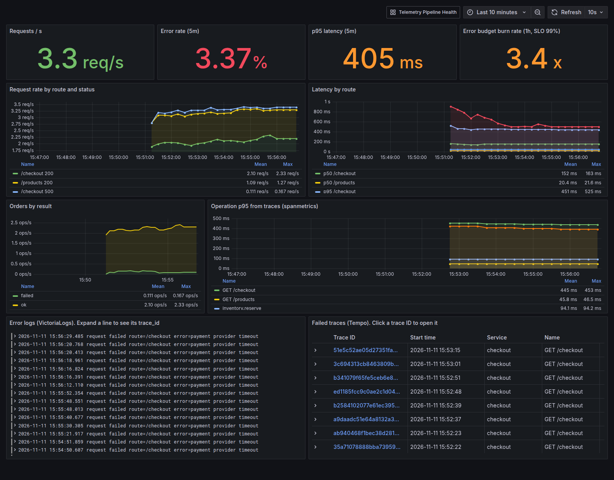
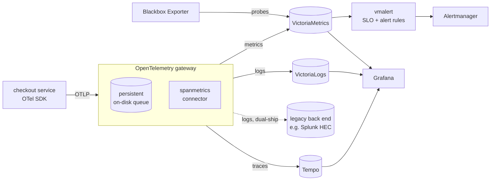
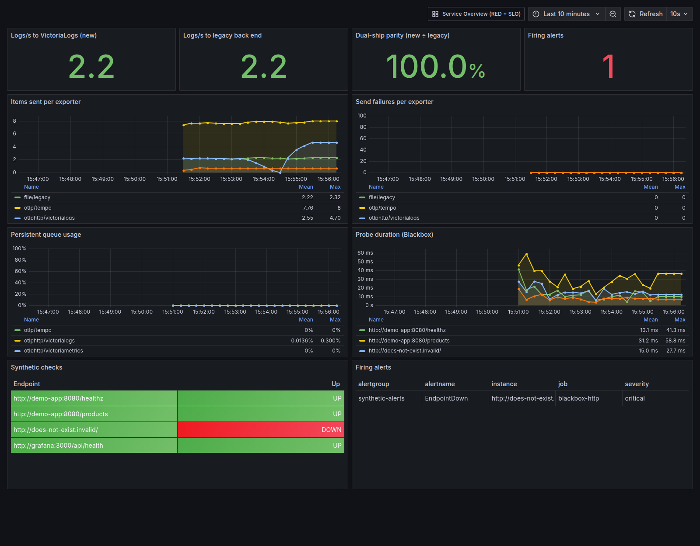

# Observability Stack: OpenTelemetry → VictoriaMetrics / VictoriaLogs / Tempo → Grafana

[](https://github.com/Yohannesmoke/observability-stack/actions/workflows/ci.yml)

A complete, open-source observability platform that starts with **one command**: metrics, logs and traces behind a single OpenTelemetry gateway, with SLO-based alerting, synthetic checks, and a **dual-shipping pipeline for migrating off a commercial tool such as Splunk with no gap in monitoring**.

It is a small-scale version of the architecture I helped design and run in production, where the pipeline handles about **2 TB of telemetry per hour**.



## Architecture



| Component | Role |
|---|---|
| **OpenTelemetry Collector** (gateway) | The single way in for all telemetry. Batching, memory limits, an on-disk retry queue, span-to-metric conversion, and fan-out to several back ends |
| **VictoriaMetrics** | Metrics storage. Takes OTLP directly and scrapes Prometheus targets |
| **VictoriaLogs** | Log storage. Every log line carries `trace_id` and `span_id` |
| **Grafana Tempo** | Trace storage, searched with TraceQL |
| **vmalert + Alertmanager** | Recording rules for SLIs, multi-window error-budget alerts, alert routing |
| **Blackbox Exporter** | Synthetic HTTP probes: checks endpoints from the outside, as a user would |
| **Grafana** | Two provisioned dashboards; logs → traces correlation |
| **Demo app + load generator** | A small "checkout" service, instrumented by hand, that fails about 5% of payments on purpose |

## Quick start

```bash
git clone https://github.com/Yohannesmoke/observability-stack && cd observability-stack
make up          # or: docker compose up -d --build
make test        # end-to-end smoke test (about 1 minute)
```

Open **http://localhost:3000** (admin / `change-me`). If a port is already in use, copy `.env.example` to `.env` and change it.

| URL | What |
|---|---|
| `localhost:3000` | Grafana: *Service Overview* and *Telemetry Pipeline Health* dashboards |
| `localhost:8428/vmui` | VictoriaMetrics query UI |
| `localhost:9428/select/vmui` | VictoriaLogs query UI |
| `localhost:8880` | vmalert: rules and alert states |
| `localhost:9093` | Alertmanager |
| `localhost:4317` / `4318` | OTLP gRPC / HTTP: point your own app here |

## What it demonstrates

### 1. Migrating off a paid platform with no monitoring gap

Applications send telemetry only to the gateway, so changing a back end is a **gateway config change, not an application change**. During the migration the logs pipeline exports to **both** the new and the legacy back end:

```yaml
logs:
  receivers: [otlp]
  processors: [memory_limiter, resource/env, batch]
  exporters: [otlphttp/victorialogs, file/legacy]   # legacy = splunk_hec in a real migration
```

The *Telemetry Pipeline Health* dashboard shows **parity**: the new back end's record count divided by the legacy one's. Each service is moved only when parity stays at 100% and its dashboards and alerts have been rebuilt and checked against the old platform. After that the legacy exporter is removed. The full process is in [docs/migration-playbook.md](docs/migration-playbook.md).



### 2. Not losing data

- **Persistent queues** (`file_storage` extension): if VictoriaLogs or Tempo goes down, or the gateway restarts, data waits on disk and is replayed later instead of being dropped.
- **`memory_limiter`** protects the gateway from out-of-memory crashes during traffic spikes.
- The pipeline **monitors itself**: alerts fire on exporter failures (`TelemetryExportFailing`) and on queues that are filling up (`TelemetryQueueFilling`).

Try it: `docker compose stop victorialogs`, wait a minute, then `docker compose start victorialogs`. During the outage the VictoriaLogs exporter's sent count stops rising while the legacy count keeps going. Once VictoriaLogs is back the gateway delivers the buffered records and the two counts match again. In a test run, both reached 555 records with 0 send failures and no missing minutes in VictoriaLogs.

### 3. SLO-based alerting, not just thresholds

Recording rules pre-compute the SLIs (`service:errors:ratio_rate5m`, `service:latency:p95_5m`...). `ErrorBudgetFastBurn` is a **multi-window burn-rate alert** for a 99% availability SLO, as described in the Google SRE workbook. It pages only when both the 1-hour and 5-minute windows burn the budget 14.4× faster than allowed, which catches real incidents without paging on short blips.

| Alert | Fires when |
|---|---|
| `ErrorBudgetFastBurn` | 1h **and** 5m error ratio > 14.4 × 1% |
| `HighErrorRate` | > 3% 5xx for 5 min (fires in the demo on purpose) |
| `HighLatencyP95` | p95 > 500 ms for 10 min |
| `EndpointDown` | a Blackbox probe fails for 2 min (the `.invalid` target always does) |
| `TelemetryExportFailing` / `TelemetryQueueFilling` | the monitoring pipeline itself is unhealthy |
| `ScrapeTargetDown` | any scrape target is down |

### 4. RED metrics for free, from traces

The `spanmetrics` connector turns every span into request, error and duration metrics, so every internal operation (`inventory.reserve`, `payment.charge`) gets latency graphs without any extra metric code.

### 5. Following one request across logs and traces

Every log record carries the `trace_id` of the request that produced it. On the Service Overview dashboard, expand an error log line to get its trace ID, or click a failed trace in the Tempo panel to see which span failed and why.

## Repository layout

```
docker-compose.yml          the whole stack (ports configurable via .env)
otel/gateway.yaml           collector pipelines, queues, spanmetrics, dual-ship
victoriametrics/scrape.yaml scrape jobs + blackbox probe targets
vmalert/rules.yaml          SLI recording rules and alerts
alertmanager/               routing (plug in Slack, Teams, PagerDuty...)
grafana/                    provisioned datasources and dashboards
demo-app/                   hand-instrumented Flask service
scripts/smoke-test.sh       end-to-end test, also run in CI
docs/migration-playbook.md  how to move a service off the legacy platform
```

## Going to production

This repo is built for clarity and runs on a laptop. In production, the same design changes in these ways:

- The gateway runs as a horizontally scaled Deployment behind a load balancer, with a `PersistentVolumeClaim` per pod for the queue. Node-level agents (DaemonSets) forward to it.
- VictoriaMetrics and VictoriaLogs run in **cluster mode** (separate insert, select and storage components) for high availability and horizontal scale.
- Everything is deployed with GitOps (Helm + Flux or Argo CD), container images are mirrored to a private registry, and secrets come from Vault through External Secrets Operator.
- See [k8s-gitops-platform](https://github.com/Yohannesmoke/k8s-gitops-platform) for the Kubernetes/GitOps version.

## License

MIT
